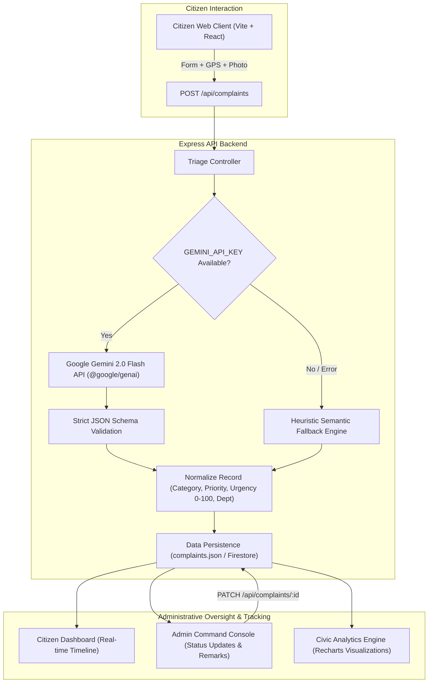

# CIVICRESOLVE
> **AI-Powered Citizen Grievance Management and Resolution Platform**  
> *Report. Track. Resolve.*

---

## 🏛️ 1. Project Overview

**CivicResolve** is an intelligent civic-tech web application that connects urban citizens directly with municipal authorities. Citizens can report public infrastructure issues—such as hazardous potholes, bursting water pipes, exposed live wires, or illegal waste overflow—in under 30 seconds. 

The platform leverages **Google Gemini 2.0 Flash** to instantly analyze multi-modal complaints (text descriptions and site photos), evaluate urgency (0–100 score), assign priority levels (*Critical, High, Medium, Low*), and route the ticket directly to the responsible municipal department (PWD, Water Board, Electricity Distribution, Sanitation, etc.) with automated field dispatch recommendations.

---

## ⚠️ 2. Problem Statement

Modern cities suffer from fragmented, opaque, and slow civic redressal mechanisms:
- **Citizen Frustration:** Traditional municipal portals are cumbersome, lack real-time feedback, and leave citizens unsure if their issue was even received.
- **Triage Bottlenecks:** Municipal call centers struggle to categorize thousands of unstructured complaints manually, resulting in life-threatening hazards (e.g., live sparking cables, open manholes) being delayed alongside minor cosmetic defects.
- **Lack of Accountability:** Status progression is often hidden, with no auditable timeline or transparent logging of field operations.

**CivicResolve solves this** with an end-to-end AI-triaged pipeline: structured intake, automated severity scoring, transparent real-time tracking, and administrative dispatch oversight.

---

## ✨ 3. Key Features

### 👤 Citizen Portal
- **Rapid Issue Submission:** Clear fields for title, detailed description, and landmark location.
- **One-Click GPS Location Detection:** Integrated with the browser Geolocation API and reverse geocoding to lock latitude, longitude, and street names.
- **Visual Photo Evidence:** Optional site photo upload with drag-and-drop, client-side preview, and base64 transmission for AI visual inspection.
- **Real-Time AI Feedback:** Instant modal breakdown displaying Gemini's classification rationale, urgency rating, and routed department.

### 📊 Citizen Grievance Feed & Real-Time Tracking
- **Interactive Redressal Feed:** Search by ID, keyword, or filter across domain categories and statuses.
- **Status Progression Timeline:** Transparent 3-stage visual tracker:
  `Reported` ➔ `In Progress` ➔ `Resolved`
- **Permanent Audit Trail:** Complete timestamped redressal activity log showing official municipal remarks.
- **Direct Grievance Tracker:** Fast lookup by unique reference ID (e.g., `CR-2026-8801`).

### 🛡️ Municipal Admin Command Console
- **Demo Admin Mode:** One-click role toggle in the navigation bar for judges and evaluators without authentication friction.
- **Live KPI Cockpit:** Total Inflow, Reported, In Progress, Resolved, and Critical Threats counters.
- **Case Management Table:** Multi-column sorting and filtering by Category, Priority, and Status.
- **Action Modal:** Update status, reassign responsible departments, record official field notes, and synchronize across all dashboards.

### 📈 Open Civic Analytics (Recharts)
- **Complaints by Category:** Volume distribution across infrastructure sectors (Bar Chart).
- **Complaints by Priority:** Urgency breakdown from Critical to Low (Donut Chart).
- **Departmental Workload:** Active case allocation per municipal wing (Horizontal Bar Chart).
- **Resolution Clearance Rate:** Proportional completion metrics and average turnaround calculation.

---

## 🛠️ 4. Technology Stack

| Layer | Technologies |
| :--- | :--- |
| **Frontend** | React 19, Vite, Tailwind CSS v4, Lucide React Icons, Recharts, Axios |
| **Backend** | Node.js, Express.js, `@google/genai` (v3.6.1), Multer, UUID, Cors, Dotenv |
| **AI Engine** | Google Gemini 2.0 Flash (`gemini-2.0-flash`) & `gemini-1.5-flash` with JSON Schema Mode |
| **Database & Sync** | Resilient persistent JSON store with Firestore REST sync hooks & client SDK real-time sync |

---

## 🏗️ 5. System Architecture



---

## 🤖 6. Gemini AI Integration Protocol

The Gemini integration is isolated inside `backend/src/services/geminiService.js`:

1. **Multimodal Analysis:** Analyzes complaint text alongside base64 site photos when uploaded.
2. **Strict JSON Schema Contract:**
   ```json
   {
     "category": "Road Infrastructure" | "Sanitation" | "Electricity" | "Water Supply" | "Drainage" | "Public Safety" | "Other",
     "subcategory": "string (specific defect)",
     "priority": "Critical" | "High" | "Medium" | "Low",
     "urgencyScore": 0-100,
     "department": "string",
     "rationale": "string",
     "recommendedAction": "string"
   }
   ```
3. **Safety Fallback:** If the API key is not configured, expired, or throttled, the internal semantic heuristic engine steps in immediately.
4. **Visual Indicator:** The UI clearly distinguishes live AI triage (`✨ Google Gemini AI (gemini-2.0-flash)`) from heuristic mode (`⚡ Heuristic Rule Engine (Fallback)`).

---

## 💻 7. Installation & Setup Instructions

### Prerequisites
- **Node.js** v18+ (tested on Node v24)
- **npm** v9+
- A modern web browser (Chrome, Edge, Firefox, Safari)

### Step 1: Clone the Repository
```bash
git clone https://github.com/SanjayR-dev/CivicResolve.git
cd CivicResolve
```

### Step 2: Configure Environment Variables
Copy the sample environment files:

**Backend:**
```bash
cp backend/.env.example backend/.env
```
Edit `backend/.env` and paste your Gemini API key:
```env
PORT=5000
GEMINI_API_KEY=your_gemini_api_key_here
```

**Frontend:**
```bash
cp frontend/.env.example frontend/.env
```
*(The frontend defaults to `VITE_API_URL=http://localhost:5000/api`)*

### Step 3: Install Dependencies
```bash
# Install backend dependencies
cd backend
npm install

# Install frontend dependencies
cd ../frontend
npm install
```

### Step 4: Run the Application
**Terminal 1 (Backend Server):**
```bash
cd backend
npm start
# Server starts on http://localhost:5000
```

**Terminal 2 (Frontend Client):**
```bash
cd frontend
npm run dev
# Frontend starts on http://localhost:5173
```

Open [http://localhost:5173](http://localhost:5173) in your browser.

---

## 🔑 8. Environment Variables Required

### Backend (`backend/.env`)
| Variable | Required | Description |
| :--- | :---: | :--- |
| `PORT` | Optional | Server port (default: `5000`) |
| `GEMINI_API_KEY` | Recommended | Google Gemini API key from [Google AI Studio](https://aistudio.google.com/apikey) |
| `GEMINI_MODEL` | Optional | Model identifier (defaults to `gemini-2.0-flash`) |
| `FIREBASE_PROJECT_ID` | Optional | Project ID for Firestore cloud synchronization |

### Frontend (`frontend/.env`)
| Variable | Required | Description |
| :--- | :---: | :--- |
| `VITE_API_URL` | Optional | Backend API base URL (default: `http://localhost:5000/api`) |
| `VITE_FIREBASE_API_KEY` | Optional | Firebase web API key |
| `VITE_FIREBASE_PROJECT_ID` | Optional | Firebase project ID |

---

## 🖼️ 9. Application Walkthrough & Previews

### A. Landing Page & Hero Section
- Clean civic design system using Navy Blue (`#0f172a`), White, and Slate Grey.
- Dynamic metric counters showing total registered, in-progress, and resolved issues.
- Interactive 4-step workflow guide.

### B. Citizen Grievance Portal
- GPS auto-detection button with coordinate locking.
- Drag-and-drop site photograph upload with live preview.
- Instant submission feedback displaying Gemini's classification rationale and urgency meter (0–100).

### C. Grievance Tracking & Status Progression
- Visual 3-stage progress bar: `Reported` ➔ `In Progress` ➔ `Resolved`.
- Timestamped audit log with official administrative remarks.

### D. Municipal Admin Command Console
- Demo Admin toggle pill in the top navigation bar.
- Case management table with category, priority, and status filters.
- Modal to update status, reassign department wings, and log field remarks.

### E. Civic Analytics Dashboard
- Responsive Recharts visualizations showing category volumes, priority breakdowns, and department distribution.

---

## 📜 License
This project was developed for hackathon evaluation and open civic innovation under the MIT License.
